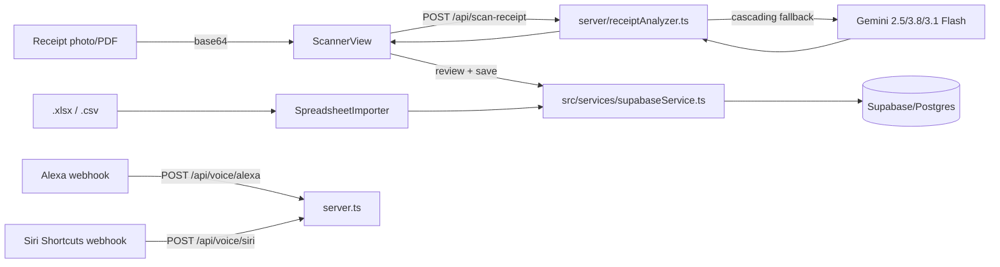

## Data Flow & Integrations

Data enters the system in three ways: (1) a photo/PDF of a receipt uploaded from the Scanner view and OCR'd by Gemini, (2) a spreadsheet (`.xlsx`/`.csv`) matching the couple's monthly closing-sheet format uploaded through the Importer, and (3) voice commands from Alexa/Siri hitting the webhook endpoints in `server.ts`. All three paths ultimately normalize into the same domain shapes (`Transaction`, `ShoppingListItem`, `FuelLog`, `Receipt`) defined in [src/types.ts](../../src/types.ts), which the front-end persists through `src/services/supabaseService.ts` to Supabase (or, for the voice-assistant demo endpoints, keeps in the in-memory store in `server.ts`).

## Module Dependencies

- `src/components/*` → `src/services/*` (CRUD calls) and `src/utils/*` (formatting, payer logic)
- `src/services/supabaseService.ts` → `src/lib/supabase.ts` (client) and `src/shared/taxonomy.ts` (category mapping)
- `server.ts` → `server/receiptAnalyzer.ts` (OCR) and `server/supabase.ts` (server-side Supabase client)
- `api/scan-receipt.ts`, `api/scan-fuel-receipt.ts` → `server/receiptAnalyzer.ts` (shared OCR logic, Vercel serverless entry points)
- `server/receiptAnalyzer.ts` → `src/shared/taxonomy.ts` (builds the classification prompt block sent to Gemini)

## Service Layer

- [src/services/supabaseService.ts](../../src/services/supabaseService.ts) — all cloud CRUD: transactions, shopping list, fuel logs, goals, receipts, subcategory defaults
- [src/services/budgetCategoriesService.ts](../../src/services/budgetCategoriesService.ts) — budget category and car-cost caching/config
- [src/services/monthlySheetConfig.ts](../../src/services/monthlySheetConfig.ts) — per-month closing-sheet configuration, with subscribe/notify helpers
- [src/services/receiptNormalizer.ts](../../src/services/receiptNormalizer.ts) — merchant/brand normalization applied to OCR output before it's shown for review
- [server/receiptAnalyzer.ts](../../server/receiptAnalyzer.ts) — Gemini Vision OCR with multi-model fallback

## High-level Flow

1. **Receipt OCR**: `ScannerView`/`AiReceiptScanner` compress the image (`src/utils/imageCompressor.ts`), send it as base64 to `/api/scan-receipt` (dev) or the Vercel function (prod), which calls `analyzeReceiptImage` in `server/receiptAnalyzer.ts`. That function tries `gemini-2.5-flash` → `gemini-3.8-flash` → `gemini-3.1-flash-lite` on transient `503`/`429` errors, parses the JSON response, and normalizes merchant names via `receiptNormalizer.ts` before returning items for human review.
2. **Spreadsheet import**: `SpreadsheetImporter`/`SpreadsheetImportView` parse `.xlsx` (via `xlsx`/SheetJS) or `.csv` (via PapaParse), map known column headers (`CATEGORIA`, `DESCRICAO`, `EXPECTATIVA`, `REALIDADE`, etc.), and feed rows into the same transaction-creation path as manual entry.
3. **Voice assistants**: Alexa and Siri webhooks in `server.ts` parse `intent`/`action` + `slots`/`params`, mutate the in-memory `shoppingListStore`/log a transaction-like event, and return a speech-formatted response (`outputSpeech` for Alexa, `spokenFeedback` for Siri).
4. **Shopping-list reconciliation**: After a receipt is scanned, `ShoppingListView`'s `tokenize`-based fuzzy matcher cross-references OCR'd item names against pending shopping-list entries to auto-mark items as bought and flag impulse purchases.

## External Integrations

- **Google Gemini API** (`@google/genai`) — multimodal OCR for receipts and fuel station receipts; requires `GEMINI_API_KEY`; retried with exponential backoff and a model fallback chain on overload.
- **Supabase** (`@supabase/supabase-js`) — primary datastore for transactions, shopping list, fuel logs, goals, and receipts; client created in `src/lib/supabase.ts` (browser) and `server/supabase.ts` (server), gated by `isSupabaseServerConfigured`.
- **Amazon Alexa** — webhook at `/api/voice/alexa`, intents: `AdicionarItemLista`, `ConsultarGastos`, `ConsultarMetas`, `VerificarEstouro`.
- **Apple Siri Shortcuts** — webhook at `/api/voice/siri`, actions: `RegistrarDespesa`, `AdicionarItem`, `ConsultarResumo`.

## Observability & Failure Modes

There is no structured logging/metrics pipeline; failures are surfaced via `console.warn`/`console.error` around Supabase calls (which fail soft, falling back to the in-memory store) and via `try/catch` around Gemini calls, which always resolve with `success: false` and a Portuguese error message rather than throwing, so the client never sees an unhandled 500 for OCR failures.
